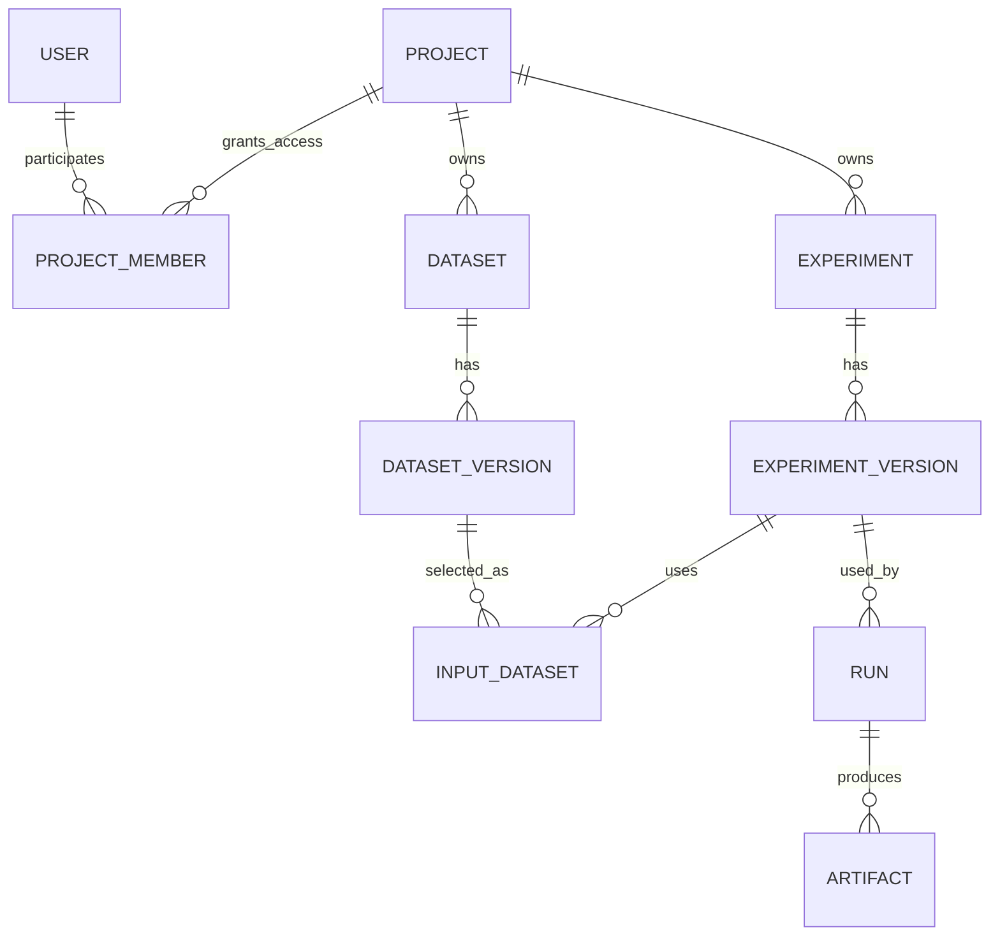
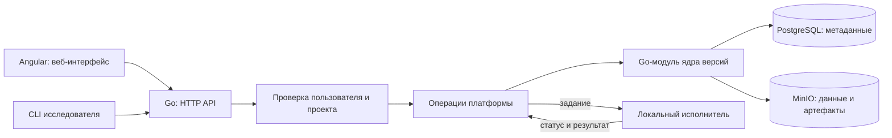

# Архитектура платформы

Статус: проект для обсуждения, 27 октября 2026 года. Описанная схема - предполагаемый двухпользовательский локальный прототип с возможностью дальнейшего развития. Она не является утверждённым техническим заданием или готовой реализацией.

## Назначение и граница

Платформа должна разделять несколько проектов, связывать каждый запуск с версией данных и условиями выполнения, показывать результаты участникам и помогать восстановить выбранный запуск. Первый сценарий рассчитан на студента и преподавателя, но число пользователей не должно быть зашито в модель.

Платформа отвечает за учетные записи, членство в проектах, доступ, API, интерфейс, хранение и исполнение. [Ядро](https://github.com/m1ssha/scientific-mlops-core) отвечает за модель версий, сравнение и план восстановления. На первом этапе платформа использует ядро как Go-модуль в одном серверном процессе; отдельный сетевой сервис ядра не требуется.

## Участники и данные

Проект - основная граница доступа и аналог репозитория исследования. Датасеты, описания экспериментов и запуски имеют явную принадлежность проекту. Запуск ссылается на конкретную версию описания эксперимента, а она - на одну или несколько конкретных версий входных датасетов через связи INPUT_DATASET. Файлы хранятся отдельно от записей о версиях.

Для первой проверки достаточно членства в проекте с двумя наборами разрешений: автор создаёт версии и запуски; проверяющий просматривает и может инициировать повторный запуск, но не меняет исходные версии. Проверки выполняются сервером для каждого действия, а не только скрытием элементов интерфейса. Общие академические группы и полноценная матрица RBAC остаются расширением.

Если один набор данных нужен двум проектам, повторное использование должно быть явным и учитывать права на исходный проект. В первом прототипе можно оставить датасеты внутри одного проекта; физическое устранение дубликатов не меняет логическую принадлежность и права.

## Компоненты локального прототипа

Развёрнутая [компонентная карта и описание контрактов](components.md) отделяют ответственность платформы от ядра, хранилищ и исполняемого исследовательского кода. Все блоки карты пока проектные.

Docker Compose запускает локальные компоненты на одной машине для разработки и демонстрации. Это не подтверждает распределённость или отказоустойчивость. Выбор PostgreSQL не обусловлен наличием всего двух пользователей; он позволяет сразу проектировать серверное хранение метаданных и согласованное изменение ссылок на текущие версии. Возможность начать с более простого хранилища остаётся открытой.

Исполнитель отделён от HTTP-обработчиков. В первой версии он запускает заранее выбранный учебный ML-пайплайн в контролируемом локальном окружении и возвращает состояние, метрики и файлы. Запуск произвольного кода из пользовательской загрузки и его изоляция требуют отдельного проектирования.

## Пользовательский сценарий

1. Автор создаёт проект и добавляет проверяющего. На сервере сохраняется членство и разрешения.
2. Автор публикует датасет и описание эксперимента. Go API проверяет доступ, вызывает ядро и получает идентификаторы неизменяемых версий.
3. Автор запускает учебный пайплайн. Локальный исполнитель получает зафиксированные входы и сохраняет результат. Завершённая запись запуска ссылается на версии входов, метрики и артефакты.
4. Проверяющий открывает проект в Angular, сравнивает два запуска и получает сведения о происхождении каждого результата.
5. Проверяющий запрашивает восстановление старого запуска. Ядро проверяет ссылки и составляет план; платформа получает данные и запускает повторное вычисление. Повторный запуск получает собственную запись, которую можно сравнить с исходной.
6. Пользователь вне проекта не может получить его метаданные или файлы через API.

CLI обращается к тому же API и выполняет те же проверки доступа, что и веб-интерфейс. Веб-приложение и CLI не должны независимо реализовывать правила версий.

## Проверка прототипа

- Два проекта сохраняют логически раздельные датасеты, версии и историю запусков.
- Автор и проверяющий видят разрешённые действия; запрос без членства отклоняется сервером.
- Новая версия данных не меняет связь старого запуска с исходной версией.
- По старому запуску можно получить полный список входов и выполнить повторный запуск в чистой рабочей среде, если все входы доступны.
- Результаты двух запусков можно сравнить по параметрам и метрикам. Критерий численного совпадения задаётся отдельно для выбранного учебного эксперимента.

## Возможные расширения

Для магистерского этапа можно исследовать поддержку групп, более гибкие права, удалённых исполнителей и устойчивость к конкретным отказам. Интеграция Slurm или PBS Pro, распределённый кэш, WebDAV и MCP - отдельные гипотезы, а не обещанный состав первой версии. Их стоит выбирать по одной проверяемой исследовательской задаче после согласования требований и доступа к инфраструктуре.

Открытые решения: учебный набор данных и пайплайн, точный формат версий, политика доступа проверяющего к повторному запуску, способ выполнения кода, критерий успешного восстановления и объём собственного программного вклада.
