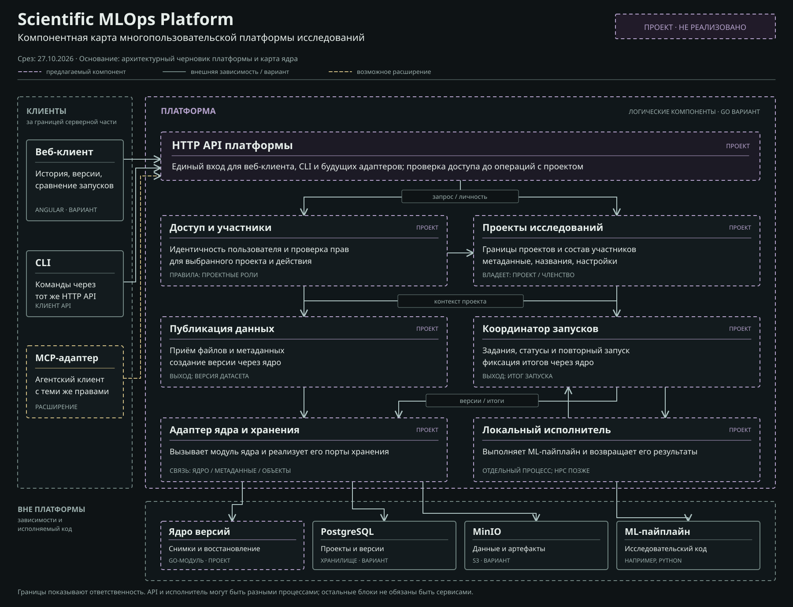

# Компонентная карта платформы

Статус: проект для обсуждения, срез на 27 октября 2026 года. [Открыть SVG-карту](component-map.svg). Карта описывает предполагаемую ответственность компонентов, а не готовую реализацию или утверждённый стек.

## Как читать карту

Граница платформы объединяет её собственные области ответственности. Компонент на карте не обязательно становится отдельным сетевым сервисом или контейнером. Пунктирная фиолетовая рамка и подпись «ПРОЕКТ» обозначают предложение. Серые блоки находятся вне ответственности платформы либо показывают варианты хранения. Жёлтый пунктир обозначает возможное позднее расширение.

Показаны основные передачи данных и команд. Карта не перечисляет каждый внутренний вызов и не означает, что веб-клиент или CLI могут обойти серверные проверки доступа.

## Компоненты платформы

| Компонент | Ответственность и собственные правила | Основной контракт |
| --- | --- | --- |
| HTTP API | Единая точка входа для веб-клиента, CLI и возможных будущих адаптеров. Передаёт запрос с проверенной личностью в прикладные операции. | Команды работы с проектами, данными и запусками; ответы для истории, сравнения и восстановления. |
| Доступ и участники | Устанавливает личность пользователя и принимает решение о разрешении конкретной операции над конкретным проектом. Сведения о членстве получает из компонента проектов. | На входе пользователь, проект и действие; на выходе разрешение или отказ. |
| Проекты исследований | Ведёт записи проектов, членство и границы видимости датасетов и запусков. Число пользователей не зашивается в модель. | Создать проект, изменить состав участников, получить доступные пользователю проекты. |
| Публикация данных | Принимает файлы и метаданные в контексте проекта, управляет незавершённой загрузкой и обращается к ядру для фиксации версии. | На входе разрешённая загрузка; на выходе идентификатор опубликованной версии данных или объяснение ошибки. |
| Координатор запусков | Создаёт задания, отслеживает их состояние, поддерживает повторный запуск и передаёт завершённый результат ядру. | На входе зафиксированный снимок условий; на выходе состояние задания и затем запись итогового запуска. |
| Адаптер ядра и хранения | Подключает отдельный Go-модуль ядра и предоставляет ему реализации интерфейсов метаданных и объектов. Не определяет правила версий заново. | Операции ядра, транзакции метаданных и доступ к крупным объектам. |
| Локальный исполнитель | Выполняет выбранный учебный ML-пайплайн вне обработки HTTP-запроса, возвращает координатору состояние, метрики и файлы результата. | На входе задание и зафиксированные входы; на выходе статус и артефакты. |

Разделение на API и исполнителя допускает разные процессы для коротких запросов и длительного вычисления. Остальные логические компоненты на первом этапе могут оставаться в одном Go-приложении. Разделение репозиториев платформы и ядра не требует сетевого вызова между ними.

## Внешние зависимости и клиенты

Angular показан как вариант веб-клиента, Go - как вариант серверной реализации и исполнителя. CLI обращается к тому же HTTP API. Возможный MCP-адаптер также должен проходить через общий API и проверки доступа; на карте он помечен как расширение, а не часть первого прототипа.

[Ядро версионирования](https://github.com/m1ssha/scientific-mlops-core) остаётся отдельным проектом. Оно создаёт версии и снимки, хранит завершённые запуски, сравнивает состояния и составляет план восстановления. Платформа отвечает за пользователя, его права и выполнение действий по этому плану.

PostgreSQL и MinIO показаны как рабочие варианты хранения. В PostgreSQL предполагаются как записи пользователей и проектов, так и метаданные версий через адаптер ядра. В MinIO предполагаются файлы датасетов и результатов. Разделение таблиц и транзакционные границы ещё требуют проектирования. Файлы проекта нельзя выдавать пользователю в обход проверки прав платформой.

ML-пайплайн находится за границей платформы: он может быть написан на Python или другом языке. В первом сценарии исполнитель запускает заранее выбранный доверенный пайплайн. Приём и безопасное выполнение произвольного пользовательского кода в эту схему не включены.

## Как проходит один запуск

1. Пользователь обращается из веб-клиента или CLI к HTTP API. Компонент доступа проверяет его право работать с выбранным проектом.
2. Публикация данных принимает файлы и через адаптер ядра создаёт версию датасета. До окончания загрузки версия не должна считаться опубликованной.
3. Пользователь выбирает снимок условий эксперимента и запрашивает запуск. Координатор создаёт задание и передаёт его локальному исполнителю. Способ хранения очереди и точные состояния задания пока не выбраны.
4. Исполнитель запускает ML-пайплайн и возвращает статус, метрики и артефакты координатору. После проверки и сохранения файлов координатор регистрирует завершённый запуск в ядре. Повторное выполнение тех же условий создаёт новую запись.
5. Второй участник проекта получает историю и сравнение через API. Для восстановления платформа запрашивает у ядра план, проверяет права и организует повторное выполнение. Отсутствующие входы должны быть показаны до запуска.

## Проверка и открытые решения

Первый прототип должен показать разделение хотя бы двух проектов, разрешённое взаимодействие двух пользователей в одном проекте, отказ в доступе постороннему пользователю, публикацию новой версии без изменения старого запуска и повторный запуск по сохранённым условиям. Ошибка выполнения не должна выглядеть как успешный завершённый результат.

Нужно отдельно определить способ аутентификации, хранение очереди и состояний заданий, границу доверия к исполняемому коду, способ передачи крупных файлов, транзакции метаданных и условия успешного восстановления. HPC-адаптер, общие академические группы, расширенная RBAC-модель, отказоустойчивое развёртывание и MCP не считаются реализованными функциями.

В SVG встроены шрифты PT Sans и PT Mono. Их лицензии: [PT Sans](licenses/PTSans-OFL.txt) и [PT Mono](licenses/PTMono-OFL.txt).
